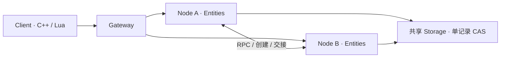

# fsnet

基于 C++20 和 Lua 5.4 的实体化网络游戏框架。C++ 提供网络、实体调度、同步与持久化机制，Lua 定义游戏规则；客户端与服务端共用实体 ID、属性模型、差量编解码和预测基础能力。

[快速开始](#快速开始) · [示例](examples/README.md) · [API 指南](docs/API_GUIDE.md) · [架构](docs/ARCHITECTURE.md) · [文档导航](docs/README.md)

## 核心模型

业务请求以实体为 RPC 载体：Manager、LoginEntity、Player 都拥有集群唯一的 `EntityId`，调用方使用实体 ID 和方法名发起请求。



- **Node 承载实体**：实体可在不同 Node 间迁移，ID 保持不变。客户端可以直连 Node，也可以通过 Gateway 接入。
- **连接决定调用权限**：RPC 显式声明 client / server 调用角色，并可限制为 owner 访问；owner 绑定逻辑 `ConnectionRef`，账号映射由业务维护。
- **客户端维护确认副本**：服务端控制可见性与操控目标，客户端据此创建 LocalPlayer / RemotePlayer 表现；预测状态与确认状态分开。
- **状态通过 CAS 提交**：运行节点的租约、fence、实体状态与回执共同保存，失去所有权的旧节点不能继续提交。

完整合同见 [全局实体](docs/GLOBAL_ENTITIES.md) 与 [连接授权](docs/CONNECTION_AUTHORITY_AND_TIMERS.md)。

## 快速开始

目前主要在 Linux / GCC 14 上验证。准备 C/C++20 编译器、CMake 3.24+、GNU make 和 Perl；可选用 Ninja。示例与进程测试需要 Python3，完整 TLS 测试还需要 `openssl` 命令。

从仓库根目录构建：

```sh
cmake -S . -B build -DCMAKE_BUILD_TYPE=Release
cmake --build build -j2
ctest --test-dir build --output-on-failure
```

CMake 下载固定版本并校验 SHA256，编译 Asio、SQLiteCpp / SQLite、libjuice、OpenSSL 和 Lua。首次构建需要网络；后续可复用构建目录中的依赖缓存。

运行示例：

```sh
python3 examples/run.py scene --build build
python3 examples/run.py scene --native --build build
python3 examples/run.py attributes --build build
python3 examples/run.py timers --build build
```

| 示例 | 展示内容 |
| --- | --- |
| scene / Lua | 登录实体 → 创建 Player → 自动客户端表现与控制 → 移动预测、确认与重放 |
| scene / native | C++ SDK 连接、实体 RPC、确认快照与控制事件 |
| attributes | vec3、mat4x4、嵌套结构、list / map / set、字段赋值与 batch |
| timers | 延迟与周期任务、取消，以及服务端强制终止后的持久恢复 |

启动器自动组合脚本并清理临时进程。示例使用 loopback 演示身份和临时存储；镜头与效果用状态和打印表示，便于替换成图形引擎接口。源码与接入说明见 [examples](examples/README.md)。

## 已实现能力

| 能力 | 机制与使用入口 |
| --- | --- |
| 全局实体 | 全局 ID 分配、创建幂等、跨节点创建、稳定引用；[实体 API](docs/OBJECT_API.md) |
| 属性同步 | 类型与权限校验、struct / vec3 / mat4x4、固定数组与有界容器；[属性 schema](docs/ENTITY_SCHEMA.md) |
| 公共差量 | 上下行共用字段路径 patch、容器编辑与显式合批；[差量生成](docs/SHARED_ATTRIBUTE_DELTAS.md) |
| 客户端预测 | 独立预测状态、服务器校正、未确认输入重放与副作用限制；[预测](docs/PREDICTION.md) |
| 生命周期 | 创建、激活、卸载、销毁、空闲回收与 drain；[生命周期](docs/ENTITY_LIFECYCLE.md) |
| 跨节点接入 | Gateway 身份委托、目录路由、属性订阅转发与恢复；[Gateway](docs/CLIENT_GATEWAY.md) |
| 定向迁移 | 指定目标 Node 的交接、租约与 fence 切换、稳定 ID 和客户端投影；[实体交接](docs/ENTITY_TRANSFER.md) |
| 持久命令 | outbox / inbox、重启重投与接收去重；[可靠投递](docs/ENTITY_DELIVERY.md) |
| 持久计时器 | 命名回调、延迟 / 指定时间 / 周期、取消与重启恢复；[计时器](docs/ENTITY_TIMERS.md) |
| 传输与运行边界 | 有界 TCP RPC、TLS 1.3 双向认证、超时 / 背压、Lua 内存与指令预算；[安全](docs/SECURITY.md) |

`call` 是普通请求，SDK 不会自动重放不确定结果；可靠实体命令使用 `send`。迁移保持实体身份并恢复订阅，但输入自动缓存重发、渲染平滑和业务补偿仍需应用处理。

## 客户端 SDK

C++ 使用 `fsnet::Client` 管理连接、实体视图、不可变确认快照和控制事件；Lua 通过同一个 Client 的 `script_host()` 接入，复用同步与预测机制。

安装到自己的目录：

```sh
cmake --install build --prefix "$PWD/.dev/install"
```

在消费项目中设置 `CMAKE_PREFIX_PATH` 指向该目录，然后使用导出的 CMake 目标：

```cmake
find_package(fsnet CONFIG REQUIRED COMPONENTS client lua)
target_link_libraries(game PRIVATE fsnet::client fsnet::lua)
```

纯原生客户端只需要 `client` 组件和 `fsnet::client`；核心目标为 `fsnet::core`。连接、事件循环与 Lua 嵌入方式见 [客户端 SDK](docs/CLIENT_SDK.md)。

## 存储与部署

`fsnet::Storage` 的最低合同是带版本读取、单记录原子 CAS 和条件删除，不要求多记录数据库事务。支持 Memory、SQLite、本地 POSIX 文件和可选 PostgreSQL，也可实现自定义后端。

启动器通过 `FSNET_STORAGE_URI` 选择后端，例如 `memory:`、`sqlite:/path/state.db`、`file:/path/records` 或 `postgresql://...`。多节点必须访问同一权威存储；本地文件后端用于同机多进程，跨机器共享存储的部署合同见 [存储](docs/STORAGE.md)。

`fsnet-service` 提供 owner / gateway 启动模式、证书身份映射、指标和优雅排空。跨机器连接使用 mTLS，明文仅允许 loopback。安装包、证书与路由配置见 [部署手册](docs/PRODUCTION.md)，模板位于 [deploy](deploy/)。

## 开发与验证

仓库提供固定版本工具准备脚本，工具和输出保存在被 Git 忽略的 `.dev/`：

```sh
bash tools/dev/bootstrap.sh
. tools/dev/activate.sh
cmake --preset debug
cmake --build --preset debug
ctest --preset debug
```

| 配置 | 用途 |
| --- | --- |
| `debug` / `release` | Lua ON，普通测试与交付示例 |
| `asan` | ASan / UBSan |
| `core` | Lua OFF |
| `postgres` | PostgreSQL 存储与服务端集成测试 |

也可直接用 CMake 选项：`FSNET_WITH_LUA=OFF` 关闭 Lua，`FSNET_SANITIZERS=ON` 开启 sanitizer，`FSNET_WITH_POSTGRES=ON` 构建 PostgreSQL 后端。PostgreSQL 额外需要 bison、flex、m4；私有服务端测试使用 `FSNET_POSTGRES_TEST_SERVER=ON`。详情见 [开发环境](docs/DEV_ENVIRONMENT.md)。

当前测试覆盖实体权限与 fencing、字段 / 容器 patch、预测约束、迁移、投递 ACK 丢失、计时器进程重启与安装包接入。配置、结果和二进制哈希见 [验证记录](docs/REMOVE_ADAPTERS_2026-10-25.md)。

性能测量使用 Release 构建：

```sh
python3 tools/review_performance.py build --runs 3 --output .dev/benchmark.json
```

各基准分别测量原生 RPC、Gateway 转发、编解码、属性值模型和复制；完整 Lua / CAS 链路单独记录。测量范围与原始样本见 [基准说明](benchmarks/README.md) 和 [实体性能报告](docs/BENCHMARK_CURRENT_ENTITIES_2026-10-26.md)。

## 当前范围

模块资源加载、安全热更新与状态迁移尚未交付。ICE / STUN / TURN 提供 P2P 原语，完整的加密传输、认证信令与后备链路仍待集成。自动 AOI、账号与会话策略、图形引擎适配由应用另行实现。

本机测试覆盖运行机制；跨机器存储 HA、网络分区、长时间容量和公网跨 NAT 仍需部署环境验证。当前版本只支持当前存储格式，不提供旧存档兼容或迁移工具。

更多资料：[文档导航](docs/README.md) · [API 使用指南](docs/API_GUIDE.md) · [第三方依赖与许可证](docs/THIRD_PARTY.md)
