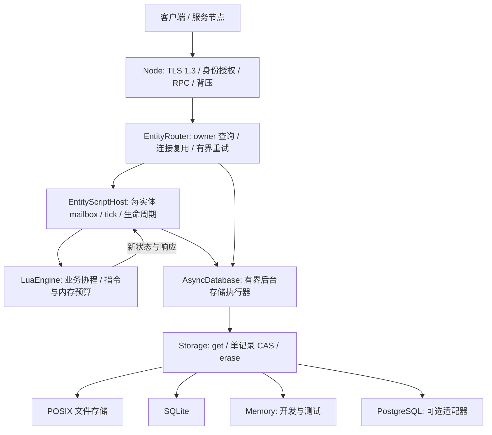

# 当前架构

C++ 只负责网络、调度、实体/场景载体、存储机制和脚本宿主；业务状态结构、规则和跨实体流程由脚本定义。Lua 是游戏业务脚本语言。



## 存储合同不依赖数据库事务

最低要求是读取带版本的记录、按预期版本原子替换、按版本删除。版本在删除/重建后不能复用。Storage 不要求 SQL、多记录事务或数据库服务。Database 是旧接口名称的兼容别名。

Memory/SQLite 可以提供可选的 transact 扩展，但实体宿主、目录路由、所有权和 EntityStore 不调用它。多实体变更不伪装成原子事务，由脚本使用消息、幂等、Saga 或 outbox 协议组织；自动 outbox 调度仍待补齐。

每个托管实体使用一个 FER1 记录：

```text
entity-key = 类型 + 实体 ID
record = owner incarnation + lease expiry + fencing counter
       + opaque script state + bounded request receipts
```

owner、租约、状态和去重结果共同受一次单记录 CAS 保护。接管会替换同一个记录，导致旧 owner 的预期版本失效；提交无需同时修改两个 key。

文件后端用 SHA-256 派生文件名，记录中仍保留原 key 并校验；跨进程 flock 保护 CAS，临时文件写入后 fsync，再同目录 rename 并 fsync 目录。删除写 tombstone，保留版本历史；损坏的记录拒绝读取，不自动初始化为空。具体保证与限制见 STORAGE.md。

## 执行与响应顺序

1. 入站请求进入类型 + ID 对应的 FIFO mailbox。
2. 后台读取实体记录，必要时用 CAS 获取/续租；租约有效且足够长时复用。
3. Lua 收到状态字节、实体 ID 和参数，执行业务；可以 await 外部 RPC。
4. Lua 返回新状态和响应。宿主用此前的记录版本 CAS 替换完整实体记录。
5. 提交成功后才返回业务成功响应，并释放 mailbox。

同一实体的不同方法和 tick 共享 mailbox，await 期间不释放。其他实体可以继续推进。Lua/Node/宿主均在所属线程调度，数据库或文件操作在独立存储线程执行。CPU 扩容使用多个分片/节点/进程，不把一个 Lua VM 放到多个线程并发执行。

脚本失败不发布返回的新状态；下一次请求恢复已提交状态。已经发送的外部 RPC 副作用不受本地 CAS 回滚，必须另行幂等。状态聚合可表示玩家、房间或场景，C++ 不内置玩法规则。

## 所有权、接管和重试

进程 owner 格式为稳定节点 ID/唯一启动 incarnation。路由器优先查找有效 owner；无 owner 或租约过期时按稳定节点 ID 做 rendezvous 选择，最终由存储 CAS 决定谁取得所有权。健康视图不授予独占写权。

过期/显式释放后，另一个宿主可恢复同一记录。旧 owner 即使仍在计算，也不能越过 CAS 发布旧状态。该保证是权威状态提交排他，不承诺网络分区时所有机器上都绝无残留计算；外部副作用仍必须携带业务幂等/隔离协议。租约接管需要同步时钟和保守的超时配置。

带请求 ID 的操作把请求与响应和新状态一起保存。重试回放已提交结果；同 ID 不同输入拒绝。默认保留最近 64 条、最多 4 MiB，淘汰后的重试可能再次执行，不能宣称无限期 exactly-once。

## 安全和 P2P

TCP 已实现 TLS 1.3 双向证书验证、目标名称校验和证书指纹路由授权。公开客户端可以只使用独立证书与空 token；内部 cluster token 不应分发给客户端。明文连接仅允许 loopback。详见 SECURITY.md。

ICE/STUN/TURN 直连与中继原语已实现并做本机验证；原始 IcePeer 不加密业务数据。认证信令、会话权限、加密数据报、UDP 禁用时的 TLS 中继后备仍在后续阶段，不能把本机 TURN 测试当成真实跨 NAT 验收。

## 当前边界

- 文件后端支持本机多进程、持久化与崩溃恢复，不会把每台机器自己的目录自动复制成一致存储。跨机器 HA 需要具备相同 CAS/持久化语义的共享或复制后端，不能靠文件复制或健康检查假定一致性。
- PostgreSQL 适配器已实现，使用单记录条件 INSERT/UPDATE/DELETE；TLS、跨连接 CAS、实体进程接管与数据库崩溃恢复已验证。主备复制/仲裁与跨机 HA 仍需单独部署验收，数据库不是实体运行时的必需条件。
- 固定步长 tick、句柄代数、快照恢复和空闲卸载已实现。完整客户端 SDK、自动 outbox、部署/观测与长期容量验证仍待完成。
- 整体仍在分阶段交付，尚未标为任意规模通用游戏的生产验收版本。当前测试证据见 VALIDATION.md。

## 客户端预测载体

共享类支持独立的只读确认副本和预测实例。应用显式提交带序号的输入，并在收到与
确认快照配套的累计处理序号后校正。运行时从确认快照构建候选预测状态、重放未确认
输入，成功后再替换旧状态；失败不移除历史或发布部分预测。预测执行禁止网络、等待
及跨对象修改，效果仅由首次成功 push 的返回值交给应用处理。业务输入协议和确定性
规则留在 Lua，服务器仍独立验证输入并通过原有 CAS 发布权威属性。具体边界见
[PREDICTION.md](PREDICTION.md)。

## 实体存在性与客户端表现

服务端脚本在可信登录上下文中 spawn/restore 权威实体，再显式 show 给场景内连接。
AttributeReplication 将连接/认证主体、实体代数与自动订阅绑定，先发送过滤后的初始
快照，再发送属性增量；hide、身份变化或卸载撤销订阅。客户端按服务器确认的 owner
选择 LocalPlayer/RemotePlayer 表现 prototype，控制目标另外同步，切换时先解除旧目标。
表现类不改变服务器实体类型，也不参与服务器授权。场景/AOI 策略留在 Lua；本阶段只
提供直连 owner 的存在性同步与单连接控制，不提供持久化场景或 Gateway 委托。详见
[ENTITY_PRESENCE.md](ENTITY_PRESENCE.md)。
