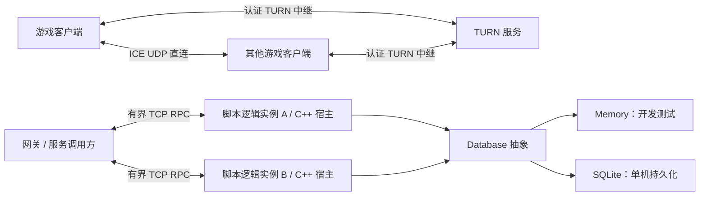

# 分布式游戏框架：边界与验收

## 已确定的职责边界

C++ 提供网络、分布式运行时、场景/实体载体、调度、存储机制与脚本宿主，不实现玩家、战斗、技能、任务和经济等游戏业务。业务全部在脚本中实现。优先支持 Lua，Ruby 作为可选适配器；统一的是宿主能力与消息边界，不是语言内部对象模型。Lua RPC 脚本宿主已实现，见 SCRIPTING.md；Lua 实体 mailbox 已实现；场景 tick 与迁移编排尚待实现。

## 当前实现

这张图展示模块关系，不表示已实现公网客户端网关或共享数据库集群。

- C++20 `Node` 是对称节点：同一连接两端均可注册服务并发起 RPC，支持服务器 P2P 网状直连。包使用网络字节序、版本、request ID、状态码和显式路由；payload 为二进制。Ruby 适配层使用 JSON。
- 单个 Node 由一个线程拥有。连接、异步收发、RPC deadline、关闭都在所属线程推进；异步回复也必须回到该线程。多实例/多进程扩展，而不是让不安全的 Ruby 对象跨线程使用。慢数据库操作/CPU 密集任务不能直接阻塞事件循环；当前 SQLite 示例是同步教学路径。
- 默认最大帧 1 MiB、每连接排队 4 MiB、1024 连接、4096 个出站调用、每连接 128 个执行中请求、30 秒空闲超时。RPC deadline 不能超过 30 秒；超时只是停止等待，不撤销已经开始的业务写入。
- `ClusterClient` 对静态成员做健康探测、过期租约和指数退避重连；rendezvous hashing 按实体稳定选择服务副本。节点停止后可将后续调用导向存活副本。仅显式标记幂等的调用，才能在原 deadline 内做一次替代节点重试。应用需要持续调用 `tick()` 和 Node 的 `poll()`。
- `Database` 以值/版本与原子多记录条件事务表达业务需求，不暴露 SQLite 连接。Memory 和 SQLite 执行同一合同；版本号在删除/重建后不复用，避免 ABA。SQLite 用 WAL、FULL synchronous 和 IMMEDIATE 事务；同一个句柄有 mutex，并发连接由数据库串行化写事务。Memory 是 copy-on-commit 的测试后端，不用于海量数据。
- Lua 5.4.7 提供受控宿主、请求协程、指令/内存/任务预算和停止清理。Lua 与 Ruby 运行同一组二进制宿主合同；两者都可独立关闭。
- Ruby 3.2+ 接口有显式 `rpc`、`Service`、GC 保根和 Fiber 内 `request`。请求等待时让出 Fiber，事件循环继续推进。用例见 `examples/player.rb` 和 `tests/ruby_test.rb`。
- 客户端 P2P 使用 libjuice 的 ICE/STUN/TURN，交换 SDP、trickle candidates 与 gathering-done。优先直连；不能建立直连时使用带凭据的 TURN。中继有 allocation/peer 配额、凭据有效期和可配置端口范围。ICE 收包队列最多 256 个 1200 字节数据报；它是无序、不保证可靠的传输，不可替代服务端权威状态。

## 生产设计约束

1. 网关与逻辑分离权限。客户端身份认证、路由授权、消息 schema、速率配额都在网关执行；共享的 cluster token 只适用于可信网络内部，不能分发给不可信游戏客户端。当前 TCP 协议明文传递 token 和 payload；ICE 数据报也没有 DTLS 加密。上线前必须增加 mTLS/DTLS 或等效的加密认证层。
2. 实体使用单写者/actor mailbox。目录租约只说明“最近健康”，不授予独占写权。`EntityStore` 已实现基于数据库 CAS 的 owner 转移、递增 fencing token，以及把 token 检查与状态写入放在同一事务中；测试确认旧 owner 无法在接管后覆盖状态。该保证依赖共享的线性一致存储，不能将两份独立 SQLite 当成一个存储。Lua 已提供本地每实体 mailbox；何时接管、自动编排与跨机存储仍未实现。
3. 钱包、库存、交易等写入使用事务和 idempotency key；事务写入与消息 outbox 原子提交。断线时，成功与未执行之间有不确定窗口，不承诺 exactly-once 网络投递。
4. 小型游戏可以单机多个服务加 SQLite；大型游戏需要生产数据库适配器（例如 PostgreSQL）、数据库 HA、分片/迁移和区域隔离。Memory/SQLite 不提供跨机器副本一致性，也不能当作 MMO 的共享 HA 数据库。
5. 公开 TURN 的 bind/external address、UDP 3478、relay UDP 范围、防火墙及短期凭据由部署配置管理。不能保证所有 NAT 都能打洞；对称 NAT 等情况需要中继，禁止 UDP 的网络还需要 TURN/TCP/TLS 后备（当前 libjuice 路径只有 UDP）。SDP/candidates 通过认证信令交换，不直接信任任意对等方。
6. 通用框架提供传输、服务生命周期、持久化和故障语义；不把 AOI、匹配、战斗帧同步、预测回滚、反作弊塞入网络核心。P2P 仅适合允许非权威状态互联的玩法。

## 验收状态

| 能力 | 当前证据 | 尚需完成 |
| --- | --- | --- |
| 可复现构建 | CMake 获取固定 SHA256 源码，构建 SQLite、Asio、libjuice；应用不链接机器预装的这些库 | 发布包、平台矩阵、供应链更新流程 |
| 安全边界与资源限制 | 非注册路由、错误 token、超大声明、挂起调用额度、超时/断线测试 | mTLS、细粒度授权、模糊测试与长期恶意流量测试 |
| 可替换存储 | 两后端合同、冲突、并发 CAS、多键原子失败/成功、删除重建、SQLite 重开持久化 | PostgreSQL 等分布式生产适配器、迁移、备份恢复演练 |
| Ruby 逻辑 | Ruby 3.3 实际调用、GC.start、Fiber 间接 RPC、JSON/数据库往返 | 每实体 mailbox、阻塞 I/O executor、业务 schema 生成 |
| 服务级容错 | 健康探测、节点停止后的幂等 RPC 切换、条件事务 fencing 拒绝旧 owner | 自动状态接管编排、共享数据库 HA、实际网络分区演练 |
| P2P/NAT/中继 | 本机 ICE 直连；仅交换 relay candidates 的 TURN 分配与游戏数据报传输 | 实际跨 NAT/跨运营商验证、加密、TURN/TCP/TLS、认证信令和会话权限 |
| 性能 | 可重跑 loopback benchmark，区分编译类型/并发/载荷/分位延迟 | DB/Ruby/公网/真实游戏负载压测及性能预算 |

因此当前是可运行的框架基础与迁移起点，不能宣称已经达到“任意规模通用游戏的生产级高可用”。剩余项目需要对应的实现和故障证据，而不是修改配置名称。

## 异步存储

`AsyncDatabase` 将 Database 操作放到独立的单工作线程，网络/VM 线程只提交任务并 poll 完成回调。排队、执行中、已完成未消费的任务共同占用请求数/声明字节预算，避免完成队列绕过背压。异常通过 exception_ptr 回到提交线程；数据库操作不得触碰 Node/VM。stop 拒绝新任务、排空已接收操作并 join；随后仍可 poll 完成回调。退出时必须先停止业务入口，再排空存储，最后销毁数据库。已经接受的写入不能用 RPC 超时撤销。
