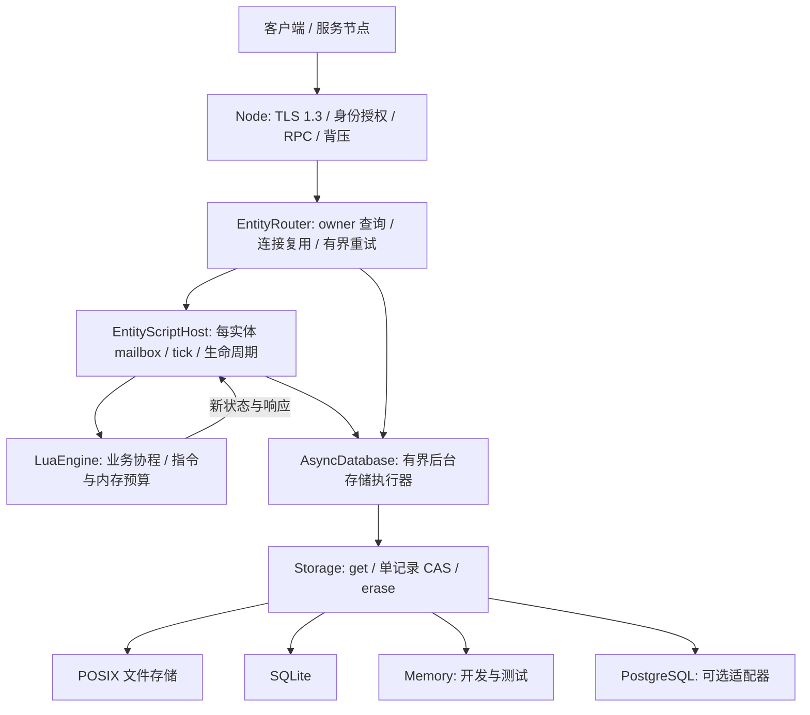
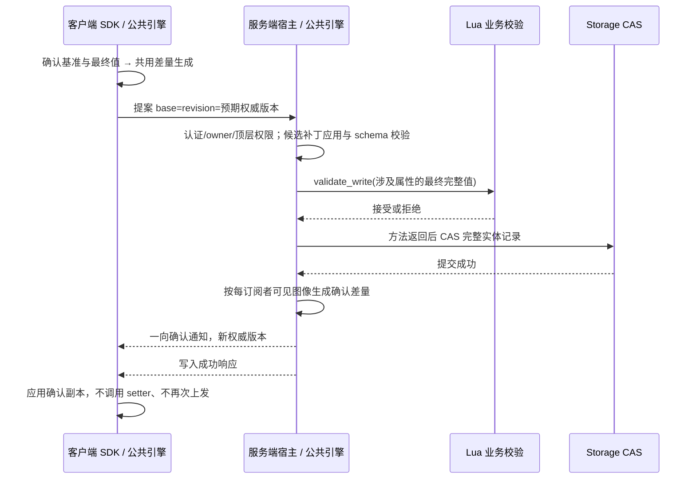

# 当前架构

实现快照：2026-10-24，`refactor/script-runtime`。阅读入口为 [文档导航](README.md) 与
[API 使用指南](API_GUIDE.md)；本文描述已实现机制，后续计划单列在 [路线图](ROADMAP.md)。

C++ 只负责网络、调度、实体/场景载体、存储机制和脚本宿主；业务状态结构、规则和跨实体流程由脚本定义。Lua 是游戏业务脚本语言。



上图的 Router 是可选路由组合；交付的 Lua 客户端当前直连配置的 owner 端点，不包含 Gateway 身份委托。

## 公共引擎与各端边界

客户端/服务端共用递归值模型、schema、FSA 编解码、`attribute_delta`、候选补丁应用和 Lua 载体机制。
客户端 SDK 用 `attribute_write_delta` 将确认基准与请求最终值交给共用生成器；服务端用
`stage_attribute_proposal` 授权并还原最终属性，再执行业务校验。广播仍由共用生成器产生每订阅者的差量。

| 公共机制 | 不能合并掉的各端职责 |
| --- | --- |
| 值、类型、路径与容器操作 | 服务端决定账号身份、属性写权限、可见范围和业务接受规则 |
| 差量生成、FSA1/2/3 编解码、候选图像应用 | 客户端持有确认副本；服务端持有权威状态并执行存储 CAS |
| 受管属性对象、Lua 运行时预算 | 客户端图形/输入适配；服务端调度、存储与生命周期适配 |
| 确定性 Lua 业务函数可共享 | 首次效果播放由客户端处理，服务端独立验证输入，回放禁止外部副作用 |

后续机制默认先检查现有公共实现，避免两端维护平行算法；业务类型与玩法继续留在 Lua。
这里账号 owner（subject）与分片 owner（持有租约/fencing 的宿主进程）是不同概念。

## 存储合同不依赖数据库事务

最低要求是读取带版本的记录、按预期版本原子替换、按版本删除。版本在删除/重建后不能复用。Storage 不要求 SQL、多记录事务或数据库服务。Database 是旧接口名称的兼容别名。

Memory/SQLite 可以提供可选的 transact 扩展，但实体宿主、目录路由、所有权和 EntityStore 不调用它。多实体变更不伪装成原子事务，由脚本使用消息、幂等、Saga 或 outbox 协议组织；自动 outbox 调度仍待补齐。

每个托管实体使用一个 FER1 记录：

```text
entity-key = 类型 + 实体 ID
record = owner incarnation + lease expiry + fencing counter
       + opaque script state + bounded request receipts
```

owner、租约、状态和去重结果共同受一次单记录 CAS 保护。接管会替换同一个记录，导致旧 owner 的预期版本失效；提交无需同时修改两个 key。

文件后端用 SHA-256 派生文件名，记录中仍保留原 key 并校验；跨进程 flock 保护 CAS，临时文件写入后 fsync，再同目录 rename 并 fsync 目录。删除写 tombstone，保留版本历史；损坏的记录拒绝读取，不自动初始化为空。具体保证与限制见 STORAGE.md。

## 执行与响应顺序

1. 入站请求进入类型 + ID 对应的 FIFO mailbox。
2. 后台读取实体记录，必要时用 CAS 获取/续租；租约有效且足够长时复用。
3. Lua 收到状态字节、实体 ID 和参数，执行业务；可以 await 外部 RPC。
4. Lua 返回新状态和响应。宿主用此前的记录版本 CAS 替换完整实体记录。
5. 提交成功后才返回业务成功响应，并释放 mailbox。

同一实体的不同方法和 tick 共享 mailbox，await 期间不释放。其他实体可以继续推进。Lua/Node/宿主均在所属线程调度，数据库或文件操作在独立存储线程执行。CPU 扩容使用多个分片/节点/进程，不把一个 Lua VM 放到多个线程并发执行。

脚本失败不发布返回的新状态；下一次请求恢复已提交状态。已经发送的外部 RPC 副作用不受本地 CAS 回滚，必须另行幂等。状态聚合可表示玩家、房间或场景，C++ 不内置玩法规则。

## 所有权、接管和重试

进程 owner 格式为稳定节点 ID/唯一启动 incarnation。路由器优先查找有效 owner；无 owner 或租约过期时按稳定节点 ID 做 rendezvous 选择，最终由存储 CAS 决定谁取得所有权。健康视图不授予独占写权。

过期/显式释放后，另一个宿主可恢复同一记录。旧 owner 即使仍在计算，也不能越过 CAS 发布旧状态。该保证是权威状态提交排他，不承诺网络分区时所有机器上都绝无残留计算；外部副作用仍必须携带业务幂等/隔离协议。租约接管需要同步时钟和保守的超时配置。

带请求 ID 的操作把请求与响应和新状态一起保存。重试回放已提交结果；同 ID 不同输入拒绝。默认保留最近 64 条、最多 4 MiB，淘汰后的重试可能再次执行，不能宣称无限期 exactly-once。

## 安全和 P2P

TCP 已实现 TLS 1.3 双向证书验证、目标名称校验和证书指纹路由授权。公开客户端可以只使用独立证书与空 token；内部 cluster token 不应分发给客户端。明文连接仅允许 loopback。详见 SECURITY.md。

ICE/STUN/TURN 直连与中继原语已实现并做本机验证；原始 IcePeer 不加密业务数据。认证信令、会话权限、加密数据报、UDP 禁用时的 TLS 中继后备仍在后续阶段，不能把本机 TURN 测试当成真实跨 NAT 验收。

## 当前边界

- 文件后端支持本机多进程、持久化与崩溃恢复，不会把每台机器自己的目录自动复制成一致存储。跨机器 HA 需要具备相同 CAS/持久化语义的共享或复制后端，不能靠文件复制或健康检查假定一致性。
- PostgreSQL 适配器已实现，使用单记录条件 INSERT/UPDATE/DELETE；TLS、跨连接 CAS、实体进程接管与数据库崩溃恢复已验证。主备复制/仲裁与跨机 HA 仍需单独部署验收，数据库不是实体运行时的必需条件。
- 固定步长 tick、句柄代数、快照恢复和空闲卸载已实现。完整客户端 SDK、自动 outbox、部署/观测与长期容量验证仍待完成。
- 整体仍在分阶段交付，尚未标为任意规模通用游戏的生产验收版本。当前测试证据见 VALIDATION.md。

## 客户端预测载体

共享类支持独立的只读确认副本和预测实例。应用显式提交带序号的输入，并在收到与
确认快照配套的累计处理序号后校正。运行时从确认快照构建候选预测状态、重放未确认
输入，成功后再替换旧状态；失败不移除历史或发布部分预测。预测执行禁止网络、等待
及跨对象修改，效果仅由首次成功 push 的返回值交给应用处理。业务输入协议和确定性
规则留在 Lua，服务器仍独立验证输入并通过原有 CAS 发布权威属性。具体边界见
[PREDICTION.md](PREDICTION.md)。

## 实体存在性与客户端表现

服务端脚本在可信登录上下文中 spawn/restore 权威实体，再显式 show 给场景内连接。
AttributeReplication 将连接/认证主体、实体代数与自动订阅绑定，先发送过滤后的初始
快照，再发送属性增量；hide、身份变化或卸载撤销订阅。客户端按服务器确认的 owner
选择 LocalPlayer/RemotePlayer 表现 prototype，控制目标另外同步，切换时先解除旧目标。
表现类不改变服务器实体类型，也不参与服务器授权。场景/AOI 策略留在 Lua；本阶段只
提供直连 owner 的存在性同步与单连接控制，不提供持久化场景或 Gateway 委托。详见
[ENTITY_PRESENCE.md](ENTITY_PRESENCE.md)。

## 属性、容器与状态载体

`AttributeValue` 是拥有独立存储的标量、结构、数组和字符串键 map。schema 声明叶类型、字段、
固定维度或动态容量；Lua 受管字段视图按路径解析当前值，不能用 rawset 绕过原生 setter。
list/set 使用序列值承载，set 的标量唯一性由 schema 检查，不内置 Item/Task 等游戏类型。

| 载体 | 修改与提交语义 |
| --- | --- |
| 服务端请求对象 | setter 立即改本次镜像，方法正常返回后 CAS，成功才发布/广播 |
| 客户端确认副本 | 仅反映服务器确认；允许写的属性发送提案并等待，不提前乐观修改 |
| batch 草稿 | 独立候选对象，回调立即修改、结束后收集最终变化；禁止等待/网络/跨对象写 |
| 本地实例 | 只写 driver 属性，不联网、不持久化 |
| 预测实例 | 确定性输入执行时写可见 driver 属性；校正时重放未确认输入，不联网 |
| 客户端表现对象 | 普通 Lua prototype 包装确认副本，适配模型/镜头/输入，不提供权威状态 |

结构、vec3/mat4x4、固定数组以及有容量上限的 list/map/set 均已实现；深复制、类型、范围、
容量、唯一性、深度/节点/字节和原生内存预算继续检查。属性权限/可见性作用于顶层属性，尚无字段级 ACL。
`persist=false` 属性只保留在有界驻留缓存中，卸载/重启/接管后恢复默认；存储的属性 FSA1 图像只包含持久属性和版本，
网络快照按权限包含当前瞬态值。详见 [结构属性](STRUCTURED_ATTRIBUTES.md) 与 [容器](CONTAINER_ATTRIBUTES.md)。

## 默认上行提案与下行确认



成功且属性有变化时才广播；无最终变化的提案仍可返回成功，但不产生属性变化通知。
拒绝、异常、版本冲突或 CAS 失败不发布部分状态。
服务端普通实体 RPC 修改也从方法返回后的 CAS 接入同一个广播路径。

提交/合并边界是一次实体方法或显式客户端 batch，不是帧末或每隔几毫秒。
服务端方法中的多次 setter 合并为一次实体提交；await 不提交、不释放 mailbox。
普通客户端赋值每条都等待服务器确认，batch 只在回调结束后发一份最终提案。
接收同步不会重执行业务函数；业务回调主动再次写属性，仍可能形成业务反馈循环。

默认 write/字段赋值/batch 上下行共用差量；没有确认基准或指定版本与本地不同则回退全值，
服务器仍校验权威版本。固定 request_id 的 SDK 写入保留稳定 FSA1 全值表示，维持原有幂等重试合同；
未变化但显式提交的属性也不跳过授权/validator。细节见 [共用差量](SHARED_ATTRIBUTE_DELTAS.md)。

## 差量选择、协议与接收应用

- FSA1：完整快照、持久化图像、整属性替换与回退提案。
- FSA2：顶层 map 键编辑和序列连续区间 splice。
- FSA3：有类型的扁平字段路径，可替换叶/子树或编辑嵌套容器。
- FSN1：属性同步信封，携带订阅/实体身份、状态与租期；`system.attributes.update` 使用一向通知。
- FER1：服务端存储的实体记录，包含租约/fencing、完整状态和有界回执，不用网络 patch 代替存储快照。

`data.position.x`、`tasks['daily.1'].progress`、`items[64].count` 可只发送变化字段。
路径中的字符串键和数字下标有类型，map 键中的点不拆层；线上数组下标从 0 开始，Lua 仍从 1 开始。
每个子树比较叶编辑、区间替换、整值替换，整条记录再比较 FSA1/FSA2/FSA3 大小，严格更省时才选新表示。
没有公共前缀树编码，没有字符串内部字节差分；新增元素发送完整新值，首次订阅/重新 watch 发送可见全量快照。

接收端核对基准版本，在候选图像上应用所有编辑、校验合并后图像，再一次发布。
非法路径/类型、缺键、越界或预算失败不推进副本版本；版本缺口使订阅失效，应用需要重新取得快照。
FSA1/FSA2 保持可读；旧端不认识 FSA3，且旧服务端会拒绝上行补丁，当前没有能力协商，需要配套升级。

上限为深度 8、4096 值节点、256 顶层属性、1 MiB 编码、256 个编辑；容器容量与订阅预算另行限制。
候选对象仍有复制与遍历、权威实体仍整体持久化，不把网络字节节省当成同等 CPU/磁盘节省。
完整路径与大小样本见 [字段差量](FIELD_PATH_DELTAS.md)，合批语义见 [合批](ATTRIBUTE_BATCHING.md)。
