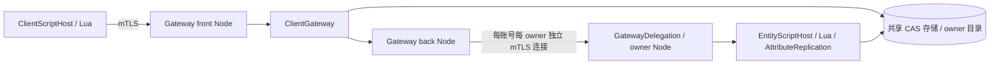

# 跨节点客户端接入

客户端只连接 Gateway。Gateway 根据共享存储中的实体 owner/租约选择节点，转发实体 RPC、
属性提案、订阅更新和存在性消息；业务及属性引擎仍由原有客户端/服务端宿主执行。
实现入口是 `client_gateway.hpp`；完整启动方式见 [交付运行手册](PRODUCTION.md)。



## 接入与信任

```cpp
// front/back 必须是不同 Node；认证策略由宿主提供。
front.identify(trusted_account_identity);
fsnet::ClientGateway gateway(front, back, database, {
    {"owner-a", "10.0.0.11", 7001, {"Player"}, "owner-a.example"},
    {"owner-b", "10.0.0.12", 7001, {"Player"}, "owner-b.example"}
});
gateway.bind_account("login", "Player");
gateway.bind_entity("Player", {"move"});
// 每轮 front.poll(); back.poll(); gateway.poll();
```

owner 端在 AttributeReplication 和 LuaEngine 之外组合：

```cpp
fsnet::GatewayDelegation delegation(owner_node, transport_identity,
    trusted_gateway_certificate, entity_host);
// 每轮 delegation.poll();
```

`transport_identity` 从已验证证书映射可信 server 身份；Trust 回调再限制允许委托的 Gateway。
`system.gateway.delegate` 只能由这些 server 连接调用，一次绑定一个账号，随后该连接的
RPC 身份固定为 **client**。每次使用重新检查原证书/信任，不能通过业务载荷指定 server 角色。
原始 peer ID 只在本节点有效，不跨节点转发。Gateway 是可信认证边界，失陷后可冒充其获授权账号。
不要向玩家分发 Gateway 私钥或把 cluster token 当作账号认证。

`bind_account` 按认证 subject 路由，登录载荷不能替换账号；该入口应在所配置类型的每个
owner 上注册相同逻辑。`bind_entity` 显式列出允许转发的方法，仍由 owner 的 schema 检查
调用者、owner、属性权限和业务校验。前后端使用同一实体封包、复制编解码和字段差量引擎，
没有另造 Gateway 属性状态或差量生成器。

## 订阅与迁移

Gateway 重映射 owner 局部订阅 ID，防止节点间碰撞；客户端 SDK 无需切换连接。
支持手工 watch 和服务端 show_to/possess 的自动存在性订阅。确认 owner 变化、卸载通知或
后端断线后，保持前端订阅 ID 和客户端表现对象，暂停属性写入，向新 owner 获取完整快照，
随后继续差量。保留最后确认值不意味着迁移期间仍可写；写入返回 overloaded。

自动恢复默认只允许实体所属账号。观察者/AOI 恢复必须通过 owner 的 `Restore` 回调重验
可见性，不能无条件允许任意 type/id。显式销毁返回 not_found 并移除副本，不自动重建实体。
同一客户端跨 owner 只有一个控制目标，切换时通知旧目标并解除旧 owner 的控制；迁移可触发
unpossess/possess 元数据回调，表现 on_spawn 不重复。

路由与 EntityRouter 共用 owner/租约优先和 rendezvous 选择。活跃租约不会被网络故障绕过；
故障接管需等待到期并通过 CAS/fencing。默认迁移上限 90 秒，覆盖默认 60 秒租约；宿主调整
租约时应同步调整 GatewayLimits。正在执行的业务 RPC **不自动重放**，超时是结果未知；
需要安全重试时由调用方保留 request_id，并遵守持久化回执的保留窗口。没有自动重发预测输入。

恢复重试间隔最多 100ms，不受较长的常规目录刷新间隔拖慢。每个迁移订阅记住本轮失败的
候选节点；对无有效租约、无指定 placement 的实体，尝试其他兼容节点后才开始下一轮。
因此 owner 线程短暂停顿超过节点健康退避时间，也不会反复选择同一个失联节点。
恢复确认安装新快照后立即使旧目录缓存过期，紧接着的客户端 RPC 会重新读取已提交 owner。

恢复完成以 `system.gateway.restore` 的明确确认回复为准：回复包含该后端订阅的完整快照、
owned 和 controlled 状态。后端先 show 再恢复控制时发出的中间 enter/control 通知不会提前
结束迁移。重复恢复已有的可见副本时，即使没有新通知，也会返回相同的最终状态；请求
controlled=false 会显式取消该副本的控制权。owner 与 Gateway 需要一起升级，新的 Gateway
会拒绝旧版本的空成功回复，避免假报恢复完成。

指定目标的交接使用服务端 `Player:transfer(id, target_node)`，原生组合、持久目标与失败重试见
[实体交接协议](ENTITY_TRANSFER.md)。Gateway 与 EntityRouter 共用 placement 路由，指定目标在
租约过期后也不会回退到其他节点。

## 容量、停止与边界

GatewayLimits 默认：256 客户端、1024 后端连接、1024 订阅、每客户端 32 订阅，
256 待处理请求、4 MiB 请求载荷、单次 3 秒、目录刷新 100 ms。Node 还有独立帧/发送队列预算。
`stats()` 提供当前资源、转发/失败/迁移计数；目录查询合并和有界缓存、轮转订阅检查防止饥饿。
容量是资源保护配置，不能视为在线人数承诺。

`drain()` 停止接收新请求，继续 poll 直到 pending 清空，再 stop；Node 必须比 Gateway 存活更久。
GatewayDelegation 独占 Node 身份解析器，运行期间不要另行替换；stop 先关闭委托连接再恢复
基础解析器，避免把旧客户端连接重新提升为 server。

当前不包含 Gateway 自身断线后的客户端自动重连、持久化场景成员、自动空间 AOI、跨机存储
复制/仲裁、配置热加载、证书在线轮换或预测输入自动重发。跨机部署可使用可选 PostgreSQL
适配器；本机 POSIX 文件验收不证明跨机 HA。
