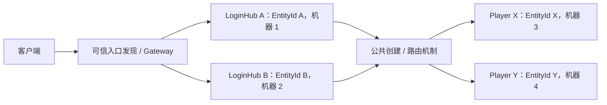

# 全局实体身份与业务 RPC 规划

2026-10-25。用户已确认本页的架构方向；分阶段进展见[实施记录](GLOBAL_ENTITIES.md)。
当前实现基线为 `2c3cd01`，仍使用 `(type, id)`、`Type.method` 和部分 `owner='id'` 规则。
本页不表示当前二进制或 SDK 已切换到新模型。
当前与新方案的 API、性能边界及实现成本见[差异与复杂度分析](ENTITY_ADDRESSING_COMPARISON.md)。

## 已确认的约束

1. 所有业务远程调用都以实体为目标。LoginHub、Player、Account、Room、Shop 等业务对象使用同一实体 RPC 机制。
2. 每个逻辑实体拥有独立、全局唯一的 EntityId。不同类型、节点和进程之间不共享或复用该身份。
3. 目标实体的 EntityId 与调用者身份、类型和物理节点分离；实体恢复、迁移或控制者变化时保留原 EntityId。
4. 多个 LoginHub 是多个独立实体，可运行在不同机器上，分担登录与创建编排。
5. 创建逻辑所在机器与被创建实体的目标机器可以不同，创建、寻址和迁移使用公共引擎机制。
6. C++ 提供分配、寻址、调度、存储、授权和协议；账号复用、登录验证与放置策略等业务规则由 Lua 定义。

这里统一的是远程调用目标。同一实体的本地 Lua 方法继续直接调用；背包项、vec3 等纯值
继续使用属性结构和容器，拥有独立生命周期或远程调用需求时才另建实体。

## 身份、类型和位置

| 概念 | 含义 | 变化边界 |
| --- | --- | --- |
| EntityId | 一个逻辑实体的全局身份 | 创建时确定，销毁后不复用 |
| EntityType / schema 版本 | 实体使用的脚本类、值与方法定义 | 属于权威元数据，不由每次调用的类型字符串决定 |
| AccountId / subject | 已认证会话代表的账号 | 可直接采用 Account 实体的 EntityId，用于归属和授权 |
| 节点 ID / owner incarnation | 当前承载实体的节点与进程实例 | 随恢复或迁移变化 |
| fencing / 本地句柄代数 | 防止旧 owner 提交、旧实例句柄继续使用 | 不作为逻辑 EntityId |
| subscription_id / 会话句柄 | 某连接上的投影与转发映射 | 可撤销、重建，不作为持久实体身份 |

这里的“分开”指区分调用者身份与目标实体身份，不强制额外引入一套账号编号体系。
账号本身可以是 Account 实体，直接以该实体的 EntityId 作为登录会话的账号身份。

例如，Account.id=1001、Player.id=2001、Pet.id=3001；Player 和 Pet 的账号归属均为 1001。
登录会话代表 Account 1001，调用 move 的目标为 Player 2001，权限检查依据二者的归属关系。
这三个 ID 只是示意值，实际均由同一全局 ID 机制分配；用户名等登录标识属于账号业务数据。

LocalPlayer、RemotePlayer、确认副本与预测载体是逻辑实体的不同视图，沿用该实体的 EntityId；
各端需要区分本地实例时，另用本地句柄/代数，不因此创建新的网络实体身份。

ID 的位宽、分配算法和客户端纯本地实体的 ID 来源需在实施时固定。此前讨论的 u64 是格式示意，
不等于已选定分配协议。实施必须覆盖多进程、重启、时钟回拨、碰撞和误配置，
权威实体注册通过 Storage 的原子能力确认身份占用，分配冲突不能覆盖已有实体。

## 统一的业务调用

目标调用模型（伪代码，不是已交付 API）：

```text
EntityRef(loginHubId).login(credentials)
EntityRef(playerId).move(input)
EntityRef(roomId).join(playerId)
```

业务消息的逻辑内容为：

```text
目标 EntityId + 方法标识 + 业务参数
```

服务端从权威目录/本地实例解析类型和 owner，再在该类型的方法表中分发。
客户端通过实体初始元数据与 schema 得知类型；后续调用无需反复发送 `Player.move` 这样的完整名称。
方法编号需有稳定映射和版本规则，不能依赖 Lua 注册顺序或未处理碰撞的字符串 hash。
全局实体寻址可以先保留方法名；数字编号是后续独立优化，不作为统一实体模型的前提。
具体帧版本与位宽在实现时确认；RPC call_id、状态码、长度边界、背压和身份校验继续保留。

连接内句柄可以作为以后压缩 EntityId 的机制，但持久引用、投递记录和迁移身份始终使用逻辑 EntityId。
持有 EntityId 或订阅句柄不授予调用权限；每次调用仍校验连接身份、账号、方法策略与实体归属。
客户端和服务端共用 EntityId、EntityRef、编解码、类型/方法表和寻址算法，不新增两套调用协议。

Node 的握手、健康探测和运维等系统控制消息继续属于基础设施。
当前直接注册的业务 `login` 路由在实施阶段迁移为 LoginHub 实体方法；业务不再另走无实体目标的 RPC 通道。

## 多 LoginHub 与跨机器创建



LoginHub 服务标签用于发现可用实例，解析结果为 EntityRef。客户端首次接入所需的入口引用
由可信配置或发现机制提供。未登录会话可以调用哪些入口方法，由接入授权策略明确限定。

创建流程需要能表达：分配/复用本次创建的 EntityId、选择目标节点、原子登记类型和初始归属、
在目标激活并提交、确认结果。创建请求重试保留同一个 EntityId 和创建幂等标识；
丢失 ACK、目标宕机或重连不能隐式生成另一批实体，也不能让同一身份对应不一致的类型或初始参数。
生命周期 hook 的外部副作用仍遵守现有幂等合同，不宣称跨外部系统 exactly-once。

多个 LoginHub 同时处理同一账号时，全局唯一 ID 只能防止身份撞号；该账号是否应复用一个 Player，
由 Lua 的账号实体或业务映射决定，可结合单实体串行调度与 CAS/幂等机制协调。
框架不把跨实体创建与账号绑定伪装成多记录原子事务。

Player 的可见性和控制建立后，继续通过实体同步自动创建客户端视图。
迁移到其他 owner 时保留 EntityId，并复用现有订阅恢复、确认/预测和控制意图协调机制。

服务实体的状态是否持久化需另行固定合同。统一实体 RPC 不等于为所有服务调用强加文件/数据库提交；
当前托管宿主仍按操作提交状态，`persist=false` 属性不会跳过该步骤。暂态服务模式尚未实现，
不能以身份重构为由省略已有持久实体的 CAS/fencing。

## 当前依赖与迁移范围

| 当前实现 | 需要的迁移 |
| --- | --- |
| `entity_record_key(type,id)` | 按全局 EntityId 定位；权威记录携带类型与版本，保持 owner/状态/回执的同记录 CAS |
| `entity_route(type,method)`、Gateway `bind_entity` | 公共 EntityRef 调用入口；由解析出的类型选择方法表 |
| Gateway `bind_account` 将 subject 作为实体 ID | 入口发现与 LoginHub 实体调用；账号到 PlayerId 的关系显式建模 |
| `owner_from_id` / Lua `owner='id'` | 独立账号归属元数据或可信解析机制，禁止由客户端自行声明归属 |
| `spawn_entity(type,id,values)` 在当前宿主创建 | 全局身份与可选目标节点的创建协议，包含幂等结果与失败恢复 |
| FSE/FSN、SDK 与订阅中的 type/id | 版本化的 EntityId 引用和初始类型元数据；兼容策略明确区分新旧读端 |
| 持久 outbox/inbox 的类型＋ID、epoch/ticket | 统一逻辑引用并迁移历史目标、渠道与回执，保留去重和旧 owner 隔离 |

已有的 `Player/alice` 与 `Pet/alice` 必须分别映射成不同的新 ID，不能直接丢弃类型后合并。
迁移需有可恢复的映射与校验；脚本状态及不透明业务 payload 内的旧引用需要业务迁移钩子。
旧记录、回执和待投递命令不得静默改义。迁移模式、旧客户端拒绝/兼容规则需在上线前固定。

## 实施顺序与验收

1. 公共 EntityId/EntityRef 与分配/claim 合同；验证跨类型、进程、重启和注入碰撞。
2. 权威元数据、账号归属、目录和存储迁移；验证同 ID 异类型冲突、旧 owner 拒绝和删除不复用。
3. 本地与远端实体调用、稳定方法映射和版本校验；验证客户端/服务端共用路径及跨账号拒绝。
4. 入口发现与跨节点幂等创建；用协议夹具验证多入口、创建重试、目标故障及 ACK 丢失。
5. SDK/Lua、存在性、预测、迁移与持久命令统一引用；验证视图 ID 稳定和历史消息去重。
6. 更新示例与 API 文档、执行现有回归和 Release benchmark，记录新协议大小、缓存 miss、吞吐及尾延迟。

各阶段形成独立 commit/push；通过对应验收后才更新“已实现”状态。
